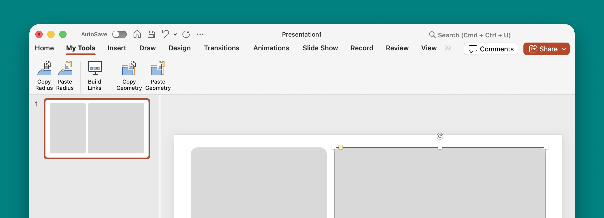

# PowerPoint Macros

A collection of VBA macros for Microsoft PowerPoint. You can use the [scripts](scripts/) individually or run the main tools from **My Tools**, a custom ribbon add-in.

## Macros

- **Copy / Paste Corner Radius** — copy a corner radius from one shape and apply it to other shapes.
- **Copy / Paste Geometry** — copy position, size, and rotation between objects, including shapes, images, and videos.
- **Build Gallery Links** — link invisible rectangle hotspots across a range of gallery slides. Prompts for the first and last slide numbers.

The toolbar includes five buttons: **Copy Radius**, **Paste Radius**, **Build Links**, **Copy Geometry**, and **Paste Geometry**.





## Install the add-in

1. Download **`MyTools.ppam`** from [Releases](https://github.com/ruzvaliakhmetov/powerpoint-macros/releases).
2. Move the file to a permanent location before installing it:

   **Mac OS**
   ```text
   ~/Library/Group Containers/UBF8T346G9.Office/User Content/Add-Ins/
   ```

   **Windows**
     ```text
   %APPDATA%\Microsoft\AddIns
   ```
3. Add it in PowerPoint:
   - **macOS:** **Tools → PowerPoint Add-ins → +**, then select the `.ppam` file.
   - **Windows:** **File → Options → Add-ins → Manage: PowerPoint Add-ins → Go → Add New**, then select the `.ppam` file.
4. Enable the add-in. The **My Tools** tab will appear in the ribbon.

On Windows, downloaded macro-enabled files may be blocked. If permitted by your organization's policies, check the file's **Properties → Unblock** option before loading it.
